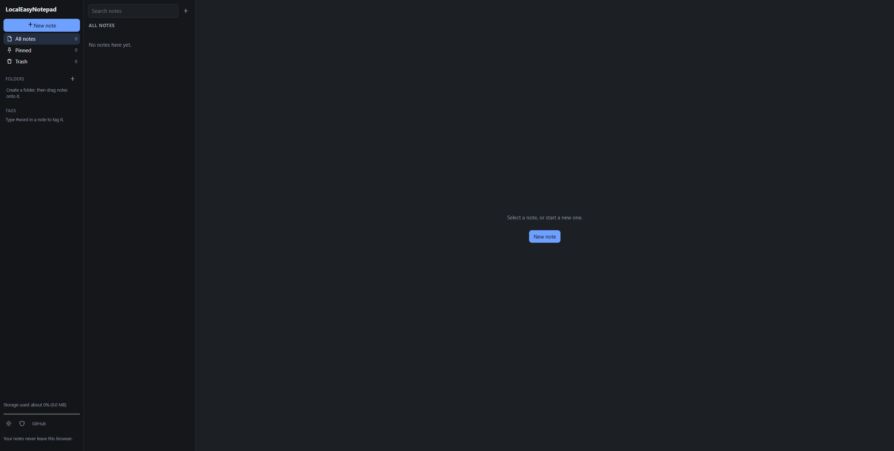

# LocalEasyNotepad

A simple, private note-taking app that runs entirely in your browser.
Your notes are stored in the browser's `localStorage`.
Plain HTML, CSS and JavaScript. No frameworks, no build step, no dependencies.

Repository: https://github.com/BNQ2k/LocalEasyNotepad



## Features

- **Notes**: autosave, instant new note (`Alt+N`), search, word count
- **Folders**: create folders, drag notes onto them (or use the folder menu on touch screens)
- **Colors**: color-code both notes and folders
- **Hashtags**: type `#idea` in a note, or add tags with the tag box; filter from the sidebar
- **Pinning**: pinned notes stay at the top of the list
- **Attachments**: attach files (up to 3 MB each); images show a thumbnail
- **Lock a note** with a PIN or password (AES-256 encryption)
- **Vault encryption**: optionally encrypt *everything* with one passphrase
- **Expiry**: set a date and time; the note then moves to the trash
- **Trash**: restore or delete forever (the trash empties itself after 30 days)
- **Duplicate** and **print** (only the note is printed)
- **Light and dark mode**, following your system by default
- **Backup**: export and import a JSON file
- **Works offline**, including as a hosted site (service worker)

## Run it

**Open the file.** Download or clone the repository and open `index.html` in a browser.

```bash
git clone https://github.com/BNQ2k/LocalEasyNotepad.git
```

## Privacy and security

- The page includes a Content Security Policy that blocks network requests (`connect-src data: blob:`), and the code makes none.
- **Locked notes**: the title, text, tags and attachments are encrypted with AES-256-GCM. The key comes from your PIN or password using PBKDF2-SHA-256 (250,000 iterations) with a random salt. A new random IV is used for every save.
- **Vault**: the same method applied to the whole data store, so even folder names and titles are hidden.
- **There is no recovery.** If you forget a PIN, password or passphrase, the data cannot be restored.
- **Use a long password for anything sensitive.** A 4-digit PIN can be guessed quickly by someone who copies your browser data and tries every combination offline.
- Encryption protects data at rest. It does not protect against malware, browser extensions you do not trust, or someone using your unlocked browser.
- Unlocked notes stay open until you press "Lock now" or close the tab.
- Clearing your browser's site data deletes your notes. **Export a backup regularly.**
- Locked notes are not included in search results while locked.

## Limits

Browsers allow roughly 5 MB of `localStorage`. The meter in the sidebar shows how much is used. Attachments are the main thing that fills it.

## Keyboard shortcuts

| Keys | Action |
| --- | --- |
| `Alt+N` | New note |
| `Ctrl/Cmd+S` | Save now (autosave already runs as you type) |

## Files

| File | Purpose |
| --- | --- |
| `index.html` | Page structure |
| `style.css` | Styling and themes |
| `app.js` | All app logic and encryption |
| `sw.js` | Offline cache when hosted over http(s) |
